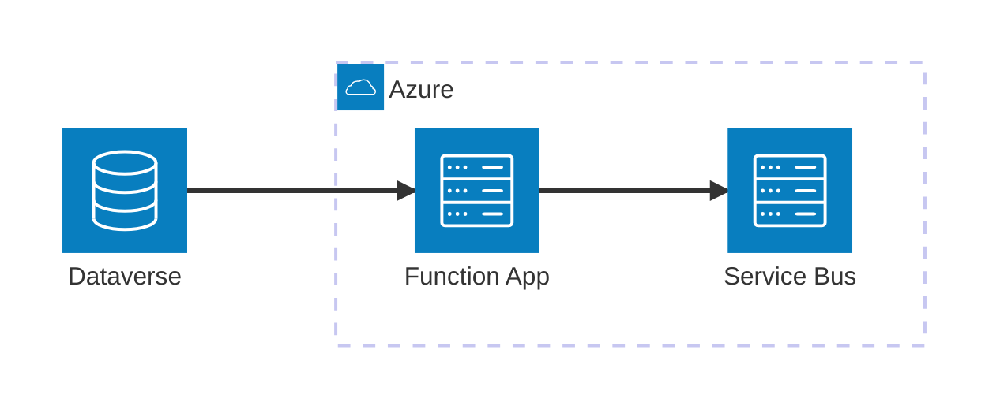

# architecture-beta (beta)

Use for cloud/service topology with groups. **Always validate; fall back to `flowchart` with subgraphs.**

- `service id(icon)[Label] in group`; built-in icons `cloud`, `database`, `disk`, `internet`, `server`.
- Edges `a:R --> L:b` with sides `L R T B`.
- Labels: plain words only (no punctuation). Put the title and description in the caption if
  `accTitle`/`accDescr` are rejected.
