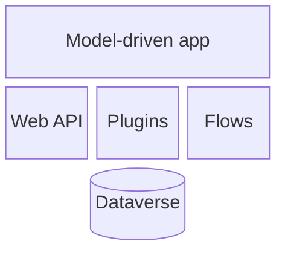

# block-beta (beta)

Use for block layouts with explicit columns (layered architecture, capability grids). **Always validate.**

- `columns N`; `id["Label"]:span`; `space` for gaps; arrows `a --> b`.
- Put the title and description in the caption (block-beta has no `accTitle` support in all renderers).
