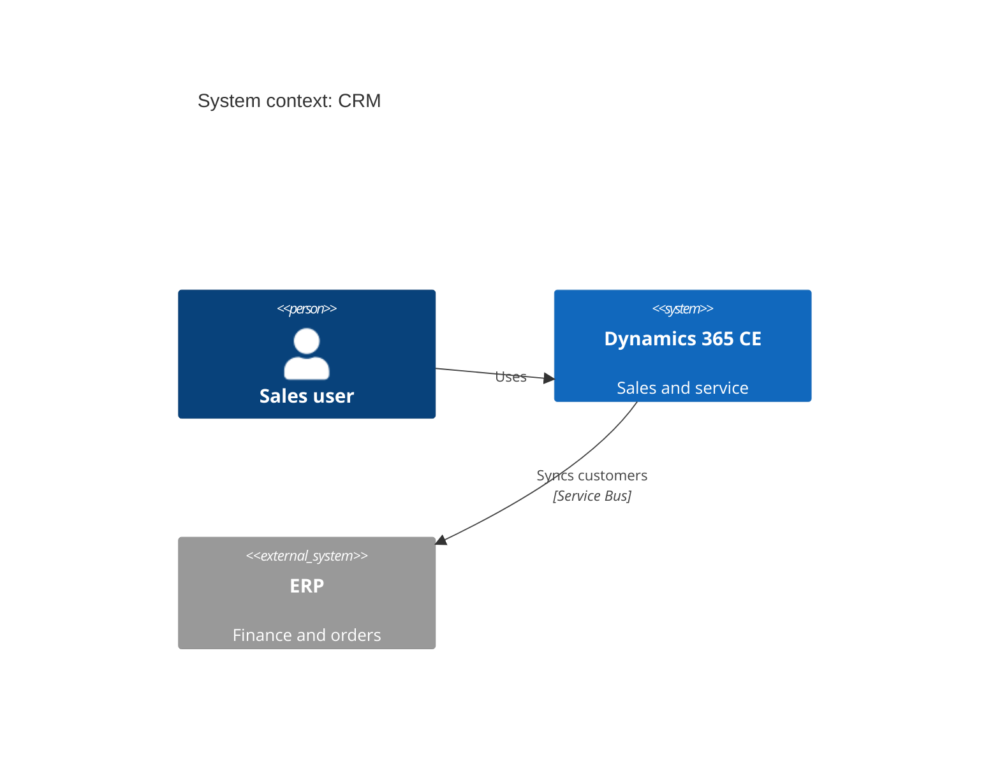

# C4 (C4Context, C4Container, C4Component, C4Dynamic, C4Deployment)

Use for architecture views. Context for executives, Container for architects. Keep ≤ ~15 elements.

- Containers: `Container(id, "Name", "Tech", "Description")`, `ContainerDb`, `ContainerQueue`; group with
  `System_Boundary(id, "Name") { ... }` or `Enterprise_Boundary`.
- `UpdateLayoutConfig($c4ShapeInRow="3", $c4BoundaryInRow="1")` to tame layout.
- A relationship label overlapping a boundary title: `UpdateRelStyle(from, to, $offsetX="…", $offsetY="-40")`.
- C4 layout is automatic and limited; if it is unreadable, use `architecture-beta` or `flowchart` with subgraphs.
