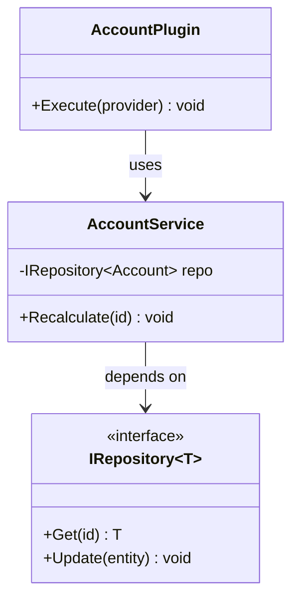

# classDiagram

Use for code structure: plugin/service/repository layers, early-bound types, PCF component classes.

- Generics `~T~`; visibility `+ - # ~`; static `$`, abstract `*`.
- Annotations `<<interface>>`, `<<abstract>>`, `<<service>>`.
- Refer to a generic class by its bare name in relationships (`IRepository`, not `IRepository~T~`).
