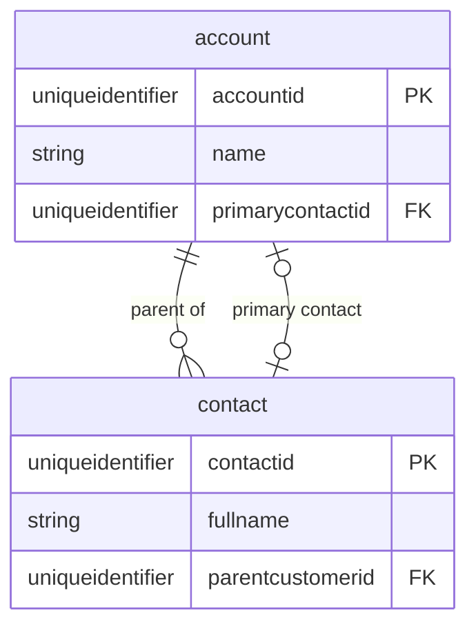

# erDiagram

Use for Dataverse tables and relationships. Entity IDs = logical names; attribute types without spaces.

- Cardinality: `||` one, `|o` zero/one, `}|` one+, `}o` zero+.
- N:N: draw the intersect table with two 1:N, or `}o--o{` labelled `"N:N"`.
- Keys `PK`, `FK`, `UK`; comments in quotes after the key.
