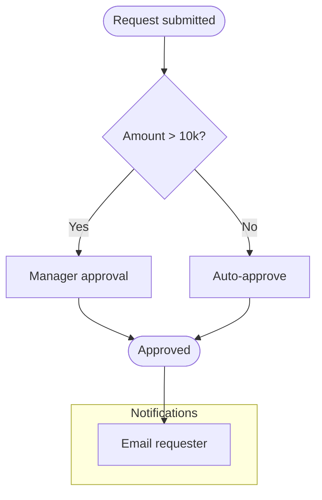

# flowchart

Use for steps, decisions and branches (Power Automate, Logic Apps, approval processes, ALM).
`TD` for hierarchies and decision trees; `LR` for pipelines and long chains.

- Shapes: `["rect"]`, `("rounded")`, `(["stadium"])`, `{"decision"}`, `[("database")]`, `[["subroutine"]]`,
  `(("circle"))`.
- Edge labels: `A -- text --> B` or `A -->|text| B`. Dotted `-.->`, thick `==>`.
- Never use bare `end` as an ID.
