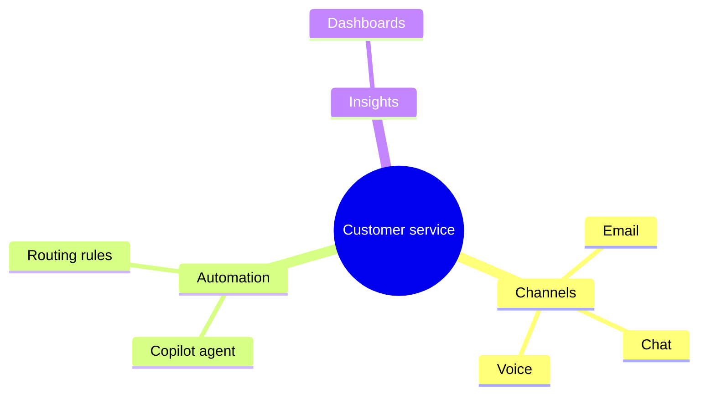

# mindmap

Use for workshop ideation and capability maps. ≤ 3 levels; indentation defines hierarchy.

- Root shape `((circle))`, `[square]`, `(rounded)`. Indent with spaces consistently.
- Put the title and description in the caption if the target renderer rejects `accTitle`/`accDescr` for mindmap.
