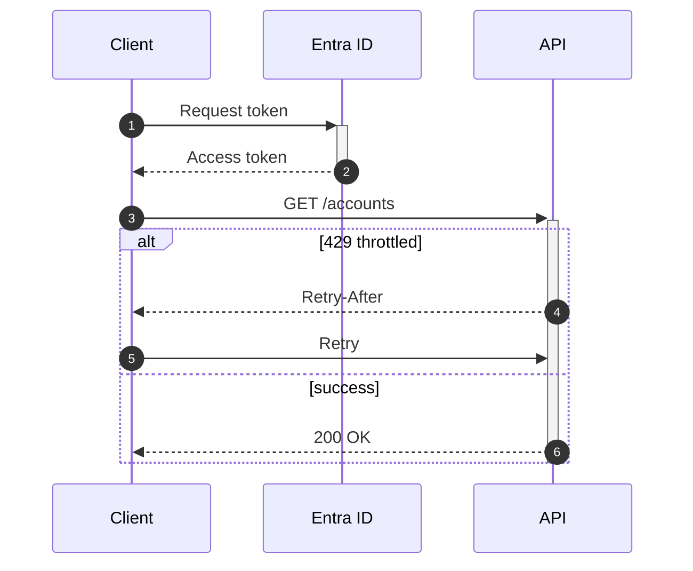

# sequenceDiagram

Use for calls over time: plugin pipelines, API integrations, PCF lifecycle, one Copilot Studio conversation.

- Arrows: `->>` sync, `-->>` reply, `-)` async, `-x` failure.
- Blocks `alt/else`, `opt`, `loop`, `par/and`, `critical/option`, `break` — each ends with `end`.
- `activate`/`deactivate` (or `+`/`-`) must balance.
