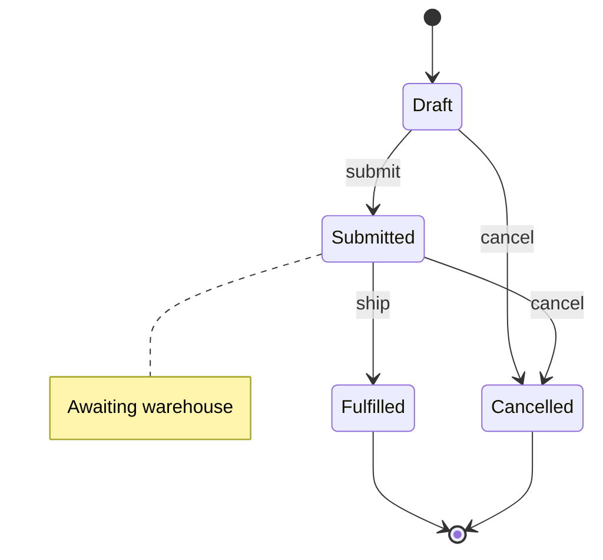

# stateDiagram-v2

Use for record lifecycles (statecode/statuscode), BPF stages, approval states.

- Composite: `state Active { [*] --> InProgress }` — one per statecode, statuscodes inside.
- Spaces in names: `state "On Hold" as OnHold`.
