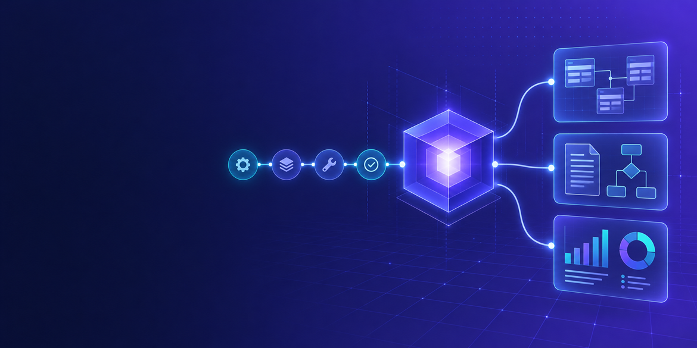

<!-- The home layout renders the hero text as the page's h1. -->
<!-- markdownlint-disable-next-line MD041 -->

::: warning Early development
The commands, inputs and package names on this site describe the target design and may change before the first
release.
:::
